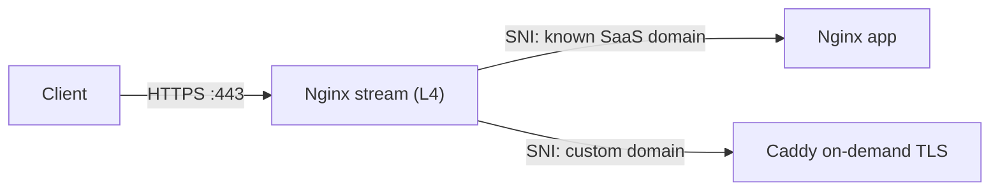

> Index of every page on this site: [llms.txt](https://mehedi.im/llms.txt)


I run [Countdown Builder](https://countdownbuilder.com), a SaaS that serves live countdown timer images for emails. Customers wanted `timer.theirbrand.com` instead of our domain, which meant issuing and renewing TLS certs for domains I don't know in advance.

Cloudflare for SaaS solves this, but I wanted to keep it on the single server I already run. So I built it with Nginx and Caddy. This is the loop I went through: what I tried, what broke, and what the final setup looks like.

## The final architecture



- **Nginx stream (Layer 4)** listens on 443. It never decrypts anything. It reads the SNI from the TLS handshake and routes the raw connection.
- **Caddy (Layer 7)** handles unknown customer domains. It terminates TLS, gets Let's Encrypt certificates on the fly, and proxies to the backend.

## Attempt 1: Plain Nginx

**Try:** one `server` block with `server_name _` and a wildcard cert.
**Result:** a wildcard cert only covers *my* domain. Customer domains throw certificate warnings, and Gmail's image proxy refuses to fetch the timer.
**Learned:** Nginx needs a cert *before* it knows which site you wanted. Dynamic domains need something that can get certs at handshake time.

## Attempt 2: Caddy on-demand TLS, alone

**Try:** Caddy on 443 with `on_demand` and an `ask` endpoint.
**Result:** it works, but now Caddy fronts my main app too, and I didn't want to migrate a working Nginx setup.
**Learned:** I wanted the main app untouched, with only unknown domains going to Caddy.

## Attempt 3: Nginx `stream` as an SNI router

Nginx's `stream` module can read the SNI from the TLS ClientHello without decrypting anything:

```nginx
stream {
    map $ssl_preread_server_name $https_backend {
        app.example.com  127.0.0.1:8081;   # main app (Nginx http block)
        example.com      127.0.0.1:8081;
        default          127.0.0.1:8443;   # everything else -> Caddy
    }

    server {
        listen 443;
        ssl_preread on;
        proxy_pass $https_backend;
    }
}
```

**Result:** HTTPS worked. Known domains hit the app, unknown ones hit Caddy and got certs on demand. I thought I was done.

## Port 80 routing doesn't work in `stream`

My first draft routed port 80 with `$http_host` inside a `stream` map. That variable doesn't exist there, because stream is Layer 4 and never parses HTTP. You get a config error or an empty variable, depending on version.

**Fix:** keep port 80 in a normal `http` block, where Host-based routing works:

```nginx
http {
    server {
        listen 80 default_server;
        server_name app.example.com example.com;
        location / { proxy_pass http://127.0.0.1:5000; }
    }

    server {
        listen 80;
        server_name _;
        location / {
            proxy_pass http://127.0.0.1:8082;   # Caddy HTTP (ACME + redirect)
            proxy_set_header Host $host;
        }
    }
}
```

## The gatekeeper endpoint

Without an `ask` endpoint, anyone can point a domain at your IP and make Caddy burn through your Let's Encrypt rate limits. Caddy calls your backend before issuing:

```http
GET /internal/domain-check?domain=clientdomain.com
```

- **200 OK:** your database recognizes the domain. Caddy gets the cert, caches it, and serves the request.
- **Anything else:** Caddy aborts the handshake.

Keep it to one indexed DB lookup, since it sits on the handshake path.

## Gotcha: ACME challenges and scanner noise

HTTP-01 needs port 80 to reach Caddy for the customer domain, which the `http` block from Bug 1 handles. If issuance fails, check first that the customer's DNS actually points at your server.

You may also see `tls-alpn challenge ... no information found to solve challenge for identifier:` in Caddy's logs every few days. Look at the `server_name` field: when it's empty, something connected with the ACME ALPN protocol but sent no hostname. Real validations carry the domain, so this is almost certainly a scanner, and Caddy is correctly refusing it.

## How I verified it

A page that loads proves nothing. I checked each path separately, from a machine other than the server:

```bash
curl -sI https://timer.customer.com/        # customer-domain path
curl -sI https://app.example.com/           # main-app path
```

Both should answer over HTTPS with no certificate warnings. To inspect the certificate Caddy actually issued:

```bash
echo | openssl s_client -connect timer.customer.com:443 -servername timer.customer.com 2>/dev/null | openssl x509 -noout -issuer -dates
```

That should show Let's Encrypt as the issuer, with dates that make sense.

Last, issue a certificate for a domain that has never touched the server and read Caddy's log:

```bash
sudo journalctl -u caddy --since "5 min ago" --no-pager | grep -iE 'obtaining|obtained|error'
```

You want `obtaining new certificate` followed by `certificate obtained successfully`. (If journalctl prints "No entries" without `sudo`, that's a permissions issue, not an empty log.)

## What I'd tell past me

1. Prototype with Let's Encrypt **staging** to avoid rate limits while debugging.
2. Test with `curl --resolve` before touching real DNS.
3. Add a per-domain issuance cap in your `ask` endpoint.

## Sitemap

See the full [sitemap](https://mehedi.im/sitemap.md) for all pages.
