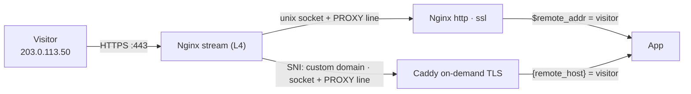

> Index of every page on this site: [llms.txt](https://mehedi.im/llms.txt)


At the end of [the unix socket swap](https://mehedi.im/blog/nginx-stream-unix-sockets) I left a loose end: my analytics for customer domains had quietly turned into one visitor. The `stream` block forwards raw TCP, so nothing downstream knows who connected — and once the hops moved to sockets, downstream doesn't even get an address. The peer on a unix socket is just "unix".

This post is the fix: PROXY protocol across the same sockets, and what it took to get Caddy and Nginx to speak it.



## Why the address disappears

The stream server terminates nothing. It peeks at the SNI, picks a backend, and copies bytes from one file descriptor to another. It never parses HTTP, so it can't add headers — there's no HTTP to attach anything to. And it can't decrypt to find out either; that's the whole point of the hop.

So Caddy's idea of the remote address is Nginx's connection, and the app's idea is Caddy. Rate limiting, abuse blocking, logs, analytics: they all see one client. The socket swap made it starker — over loopback TCP at least everyone agreed on `127.0.0.1`; over a unix socket the peer address is a path that tells you nothing.

## What PROXY protocol is

A short plaintext line that the stream block prepends to the connection, before the TLS handshake:

```text
PROXY TCP4 203.0.113.50 10.0.0.5 51234 443
```

The backend reads the line, strips it, and treats `203.0.113.50` as the connection's remote address. TLS then proceeds untouched — the ClientHello is byte-for-byte what the visitor sent.

One thing to be clear about: the header is a claim, not proof. Whoever can connect to a PROXY-protocol listener can send `PROXY TCP4 1.2.3.4 ...` and impersonate any IP, which quietly defeats rate limits and bans. This is where the `0750` socket directory from the last post stops being a nice-to-have: only Caddy and the Nginx group can reach these listeners at all. On loopback TCP, every process on the box could.

## Sending it from stream

```nginx
server {
    listen 443;
    ssl_preread on;
    proxy_pass $https_backend;
    proxy_protocol on;
}
```

The trap is that this is all-or-nothing. `proxy_protocol on` prefixes every connection this server forwards, including the ones headed for the main app. **Every backend in the map must accept PROXY protocol, or none of them can.**

## The Caddy side

Caddy speaks PROXY protocol through a listener wrapper:

```caddy
{
    http_port 8082

    on_demand_tls {
        ask http://127.0.0.1:8000/internal/domain-check
    }

    servers unix//run/app-sockets/caddy-tls.sock|0666 {
        protocols h1 h2
        listener_wrappers {
            proxy_protocol
            tls
        }
    }
}
```

Three details, and I hit all three:

- **The directive is listener_wrappers.** I typed `listen_wrappers` first and got `unrecognized servers option`.
- **Order matters.** `proxy_protocol` must come before `tls`, because the PROXY line arrives before the ClientHello. Reverse them and Caddy tries to parse `PROXY TCP4...` as a TLS handshake.
- **Scope it to the socket.** A bare `servers { }` applies to every listener, including plain HTTP on 8082 — and a `tls` wrapper on an ACME port breaks HTTP-01 challenges and the redirect. The address after `servers` has to match the listener Caddy actually creates, and a mismatch fails silently: `caddy validate` still passes. Check it with adapt:

```bash
sudo caddy adapt --config /etc/caddy/Caddyfile --pretty | grep -n -B3 -A10 listener_wrappers
```

You want `proxy_protocol` then `tls` inside a server whose `listen` is the socket path. If the block is missing, copy the exact `"listen"` string from the adapt output into the `servers` line.

(`protocols h1 h2` is there because the socket carries TCP only — there's no UDP on it for HTTP/3.)

## The main app has to accept it too

The other backend in the map is Nginx's own `http` server. Its `listen` line gains a parameter, plus two directives to actually use the header:

```nginx
listen unix:/run/app-sockets/nginx-app.sock ssl proxy_protocol;

set_real_ip_from unix:;
real_ip_header   proxy_protocol;
```

`proxy_protocol` on the `listen` line makes Nginx *parse* the line. `set_real_ip_from` together with `real_ip_header proxy_protocol` makes it *use* the line to set `$remote_addr`. You need both — parse alone just strips the header and leaves you back at "no useful address". For a unix socket peer, the trusted source is `unix:`.

Because one side now sends the header and the other side *requires* it, there's no rolling this out one backend at a time. Switch both sides together:

```bash
sudo nginx -t && sudo systemctl restart caddy && sudo systemctl reload nginx
```

## What this buys downstream

With the wrapper in place, `{remote_host}` in Caddy resolves to the visitor, so anything it proxies can pass the address on:

```caddy
reverse_proxy 127.0.0.1:3000 {
    header_up X-Real-IP {remote_host}
}
```

And in the Nginx `http` block, `$remote_addr` is the visitor again — which rate limiting and logs pick up with no further config.

## How I verified it

A page that loads proves nothing. I checked each path separately, from a machine other than the server:

```bash
curl -s ifconfig.me                                # your public IP
curl -s https://timer.customer.com/check-ip        # customer-domain path
curl -s https://app.example.com/check-ip           # main-app path
```

Both `/check-ip` endpoints should print your public IP. (`ifconfig.me` may answer over IPv6 while your other path returns IPv4; force a family with `-4` or `-6` if they disagree.)

## What I'd tell past me

1. Treat `proxy_protocol` as a change to the whole proxy chain, not one backend. Every backend in the map accepts it, or none can — and both sides switch together.
2. After editing `servers <address>` in Caddy, run `caddy adapt` and confirm the wrapper attached. `validate` passing doesn't prove it.
3. Check real client IPs in the logs on day one, not after a week of bad analytics.

---

**Read the series from the start:** [Multi-Tenant Custom Domains](https://mehedi.im/blog/multi-tenant-custom-domains) and [the unix socket swap](https://mehedi.im/blog/nginx-stream-unix-sockets) set up everything this post leans on.

## Sitemap

See the full [sitemap](https://mehedi.im/sitemap.md) for all pages.
