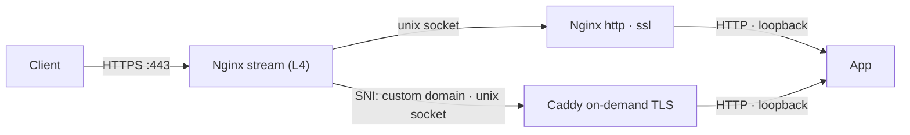

In [Multi-Tenant Custom Domains](/blog/multi-tenant-custom-domains) I finished with an Nginx `stream` block on 443 that reads the SNI and forwards the connection. Known domains went to `127.0.0.1:8081`, where a normal `http` server handled TLS. Everything else went to Caddy on `127.0.0.1:8443`.

It worked fine. It also bugged me, because both of those hops are just processes on the same machine talking to each other over TCP. One of them is Nginx connecting to itself.

So I swapped both for Unix sockets. The main reason is simple: these hops never leave the machine, so they shouldn't be paying for the network stack at all.



## Why bother

Both hops are processes on the same machine talking to each other. Over TCP that means a full handshake, loopback addressing, ephemeral ports, and `TIME_WAIT` cleanup on every connection — the kernel running its whole networking routine for a conversation that never leaves the box.

A Unix socket skips all of it. The kernel moves bytes directly between the two processes, and there's no network stack in the path. You also drop two arbitrary port numbers that someone, probably you in six months, will have to wonder about.

The socket being a file has a side effect I like too: to connect, you need permission on the socket and on the directory it lives in. Everything here is on one machine that I control, so that's not what drove the change — but it costs nothing.

## One directory for all of them

I put both sockets in the same directory, so there's one place to check and one permission rule to reason about:

```bash
echo 'd /run/app-sockets 0750 caddy www-data -' | sudo tee /etc/tmpfiles.d/app-sockets.conf
sudo systemd-tmpfiles --create
```

The directory belongs to `caddy`, with group `www-data` and mode `0750`. Check which user your Nginx workers run as (`grep '^user' /etc/nginx/nginx.conf`) and use that as the group if it isn't `www-data`.

You might wonder how Nginx creates a socket in a directory its workers can't write to. It doesn't need the workers for that. The master process runs as root and creates the listening sockets at startup. The workers, running as `www-data`, only have to walk into the directory and connect, and the group's read and execute bits cover that.

I put it under `/run` rather than `/tmp` because `/run` is tmpfs. The directory and any stale sockets disappear on reboot, and the tmpfiles rule recreates the directory at boot.

## The Nginx side

This is the stream map from the last post, with the targets swapped for socket paths:

```nginx
stream {
    map $ssl_preread_server_name $https_backend {
        app.example.com  unix:/run/app-sockets/nginx-app.sock;
        example.com      unix:/run/app-sockets/nginx-app.sock;
        default          unix:/run/app-sockets/caddy-tls.sock;
    }

    server {
        listen 443;
        ssl_preread on;
        proxy_pass $https_backend;
    }
}
```

The `unix:` prefix is required in the map values. The `http` server for the main app used to say `listen 127.0.0.1:8081 ssl;`, and now it says:

```nginx
listen unix:/run/app-sockets/nginx-app.sock ssl;
```

Nothing else in that block changes. The TLS handshake passes through the socket exactly as it did over TCP, the SNI is still in the ClientHello, and `server_name` and certificate selection keep working. The map value and the `listen` line have to match exactly. Copy one from the other instead of retyping.

## The Caddy side

Caddy can bind a site to a socket with `bind`. I also dropped `https_port 8443`, since there's no port anymore:

```caddy
{
    http_port 8082

    on_demand_tls {
        ask http://127.0.0.1:8000/internal/domain-check
    }
}

https:// {
    bind unix//run/app-sockets/caddy-tls.sock|0666

    tls {
        on_demand
    }

    # ...the rest of your handlers, unchanged
}
```

The `|0666` is the socket's file mode. I set it explicitly so the Nginx worker is certain to be able to connect. It looks wide open, but remember the directory is `0750`, so only `caddy` and the Nginx group can get to the file at all.

`http_port 8082` stays a normal TCP port. Port 80 doesn't go through the `stream` block. It's handled by a regular `http` block that proxies to Caddy for ACME HTTP-01 challenges and the redirect, so that path isn't part of this change.

## Switching over

Do Caddy first, so the socket exists before Nginx starts sending to it:

```bash
sudo caddy validate --config /etc/caddy/Caddyfile
sudo nginx -t && sudo systemctl restart caddy && sudo systemctl reload nginx
```

I'd do this one hop at a time the first time. Move the Nginx app hop, check the main site, then do Caddy. If something breaks, you know which half caused it.

## What I left on TCP

The app itself still listens on plain HTTP over loopback. `proxy_pass http://127.0.0.1:...` in Nginx and `reverse_proxy` in Caddy are exactly as they were.

Sockets make sense when you control both ends and the connection never needs to leave the machine. For the Nginx-to-Nginx and Nginx-to-Caddy hops, that's true. The app is a separate process with its own lifecycle, and it's also what `curl` and health checks talk to. Keeping that boring is worth more to me than a slightly shorter path.

## Bookkeeping, not bandwidth

To be clear about what you're dropping: it's bookkeeping, not bandwidth. You skip the TCP handshake and the kernel's per-connection networking work on these hops. There are no ports involved, so there's no `TIME_WAIT` pile on the closing side after a burst of connections. That's exactly the overhead I wanted gone on hops that don't need a network — I'm just not going to claim you'll feel it in a benchmark. If you want to see the `TIME_WAIT` difference yourself, count them before and after:

```bash
ss -tan state time-wait | grep -E ':8081|:8443' | wc -l
```

After the switch that should be zero, because those ports don't exist.

## When it breaks

The error log is clear about it. These are the ones I'd expect:

- **`connect() to unix:/run/app-sockets/... failed (2: No such file or directory)`.** Nothing is listening on that path. Usually the map value and the `listen` line don't match, or Caddy hasn't been restarted yet.
- **`(13: Permission denied)`.** The worker can't reach the socket. Check `ls -ld /run/app-sockets` (owner `caddy`, group matching your Nginx user, mode `0750`) and which user the workers run as.

## How I checked it

```bash
ls -l /run/app-sockets/
ss -xlp | grep app-sockets      # both sockets listening
ss -tlnp | grep -E ':8081|:8443'  # should print nothing
curl -sI https://app.example.com/
curl --resolve timer.customer.com:443:YOUR_SERVER_IP -sI https://timer.customer.com/
```

The first three confirm the sockets exist and the old ports are gone. The two `curl` calls run the real path end to end, and one is for a customer domain, so you know Caddy is serving through its socket. I also checked that certificate issuance still worked for a domain that had never hit the server.

You can also test the app's socket directly, skipping the `stream` layer. This needs `sudo`, because your shell user isn't in the directory's group:

```bash
sudo curl --unix-socket /run/app-sockets/nginx-app.sock -sI https://app.example.com/
```

## One thing it broke

Before the switch, the `http` block saw `127.0.0.1` as the client. Now over a socket it sees no useful address at all. And Caddy still only sees Nginx, not the real visitor. The `stream` hop forwards raw TCP, so nothing downstream knows who connected. My analytics for customer domains quietly turned into one visitor.

Fixing that takes PROXY protocol, and it has a couple of traps. That's the next post.
